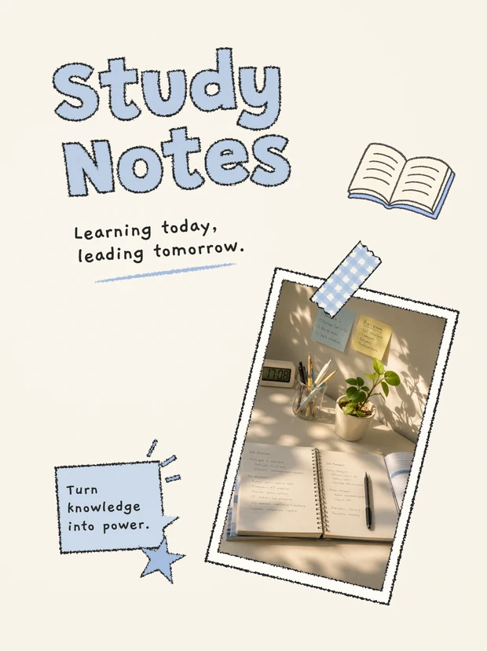
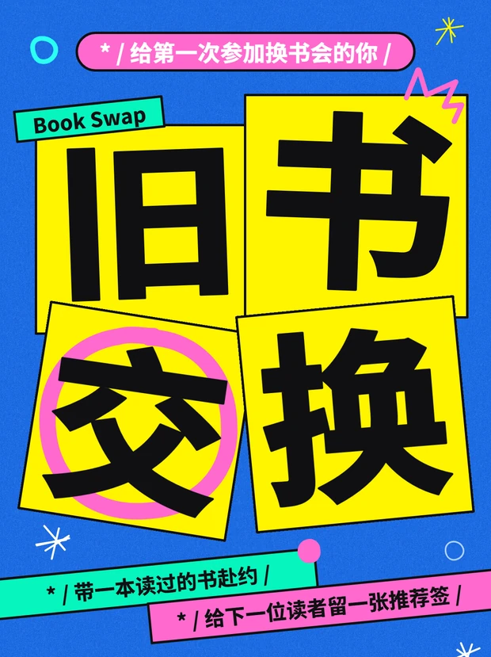
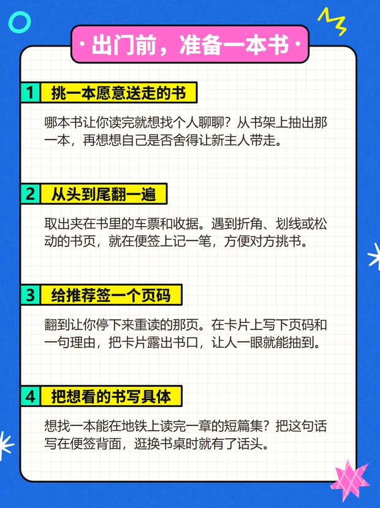
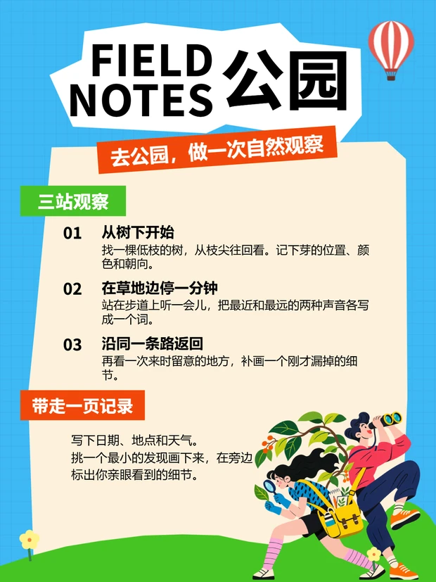

# 小红书封面与图文套图

用 JSON 写文案、选配图，在本机用 Chromium 渲染成 PNG。内置的四款模板输出 1242 × 1660 像素。也可以按自己的参考图编排图层，分别保留封面和内页的原始比例。

## 快速开始

准备 Node.js 20 或更高版本，以及本机已安装的 Chrome、Edge 或 Chromium。在项目根目录运行以下命令。

```sh
npm ci
npm run check-browser
npm run render
```

默认使用厦门旅行的贴纸手帐样稿，生成 `output/note_cover.png`。要一次生成下方四款内置模板，运行 `npm run render:all`。浏览器安装在自定义位置时，可通过 `--browser` 传入可执行文件路径，或设置环境变量 `CHROME_PATH`。

## 内置模板

下图均由随仓库提供的 JSON 样稿渲染，缩小用于预览。点击模板名可以打开对应样稿。

| [纸页手记](examples/paper-notes.json) | [贴纸手帐](examples/sticker-journal.json) | [涂鸦大字报](examples/doodle-poster.json) |
| --- | --- | --- |
|  |  |  |
| `npm run render:paper-notes` | `npm run render:sticker-journal` | `npm run render:doodle-poster` |
| 两行标题搭配相框照片。用 `note_quote` 写便签，用 `assets.main_illustration` 换照片。 | 用 `assets.main_sticker` 换主角，`assets.stickers` 中的 `role: "scene"` 指定次景，`checklist` 写清单。 | `lines` 接受 1 至 5 行标题，`highlight_words` 指定要标黄的词。 |

### 荧光字卡

四个字块组成封面标题，内页把每个动作排成一条带编号的说明。《旧书交换》共三页，从出门前挑书、写推荐签，到现场交换和回家阅读。[旧书交换样稿](examples/neon-cards.json)

| 封面 | 第一章 · 出门前，准备一本书 |
| --- | --- |
|  |  |

```sh
npm run render:neon-cards
```

在 `cover.audience` 写给谁看，`cover.tiles` 填四个字块，`cover.ribbons` 填两条短句。每个 `sections[]` 提供章名 `heading` 和条目 `items`，每条包含 `title` 与 `body`。每章另起一页，每页最多五条，长文按实际高度续页。生成的 `output/neon-cards/pages.json` 按发布顺序列出封面和全部内页。

## 写自己的稿件

例如，把下面的内容保存为项目根目录的 `my-poster.json`，即可生成一张薄荷绿的读书海报。

```json
{
  "template": "doodle-poster",
  "lines": ["今晚读书", "带张书签"],
  "highlight_words": ["书签"],
  "theme_color": "mint_teal"
}
```

```sh
npm run render -- my-poster.json output/my-poster.png
```

单张封面传入 PNG 文件名，套图传入目录。第一次输出套图时使用新目录或空目录。下次向同一目录渲染，生成器会更新 `pages.json` 并移除旧清单中多出的页。本地配图和自定义字体路径以 `assets/` 开头时从项目根目录读取，其他相对路径以稿件所在目录为准。项目字体、共用样式表和字体许可集中在 [assets/fonts](assets/fonts/)。

## 用上传的图片制作同款

公园观察样稿从两张参考图提取方格底、报头与橙色横条，再用新的插画和正文组成一套两页的自然观察笔记。[可编辑样稿](examples/reference-field.json) · [参考图创作流程](SKILL.md#根据用户上传的参考图创作)

| 公园观察 · 封面 | 公园观察 · 内页 |
| --- | --- |
|  |  |

```sh
node scripts/render.js --inspect-reference assets/references/city-cover.png assets/references/city-inside.png
npm run render:reference-field
```

检查命令输出尺寸、SHA-256 和主要颜色。第二条命令按样稿生成 `output/reference-field/`，其中的 `pages.json` 记录页序。编写自己的 `kind: "reference-source"`、`schemaVersion: 1` 稿件时，可对照下表填写。

| 字段 | 填写内容 |
| --- | --- |
| `references.cover`、`references.inside` | 每张原图的本地 `path` 和非空的观察记录 `observations`，可用 `sha256` 锁定原图。参考图的相对路径从稿件目录读取。制作独立封面时只填 `cover`。 |
| `design.cover`、`design.inside`、`design.shared` | 从底到顶排列图层，用 `box: [左, 上, 宽, 高]` 表示占页面的比例。文字用 `bind` 绑定文案，图片可指定素材、绑定可替换图片，或裁取原图局部。 |
| `design.colors`、`design.fonts` | 颜色可填十六进制值，也可从原图指定位置取色。字体可按 `display`、`body`、`hand` 指定本地文件及字重。 |
| `content.cover`、`content.sections` | 填入图层绑定的实际文案和图片路径。内页继承封面字段，可逐章覆盖，用 `list` 图层自动续排条目。 |

## 贴纸手帐定稿与离线重绘

需要保存可重绘的手帐时，用 `kind: "cover-source"` 记录正文、封面文案、素材和排版。随附的散步笔记稿以默认生成的厦门封面为参考。[散步笔记创作稿](examples/journal.source.json)

- `visualReference` 用 `path` 指定参考图。使用普通图片时，填入 `observations`、`composition` 和 `requiredSlots`。至少选两个构图区块，例如竖幅人物图选 `hero` 和 `title`。使用附有定稿的 PNG 时，渲染器核对像素后读取其布局。
- `content.title`、`content.body` 保存笔记的标题和正文，`content.cover` 放封面实际展示的短句和最多四条清单。需要微调时，用 `layout.slots` 指定区块位置和尺寸，用 `assets.main_sticker_style.focus` 指定主图要保留的焦点。

```sh
npm run render
node scripts/render.js examples/journal.source.json output/final.png --freeze output/final.json
node scripts/render.js --replay-only output/final.json output/replay.png
node scripts/verify-offline.js output/final.json output/final.png
```

定稿嵌入版式、字体和图片，通过离线重绘的像素校验后才写出。最后一条命令在空目录重绘并逐像素比较。使用相同系统和浏览器版本可复核结果。
